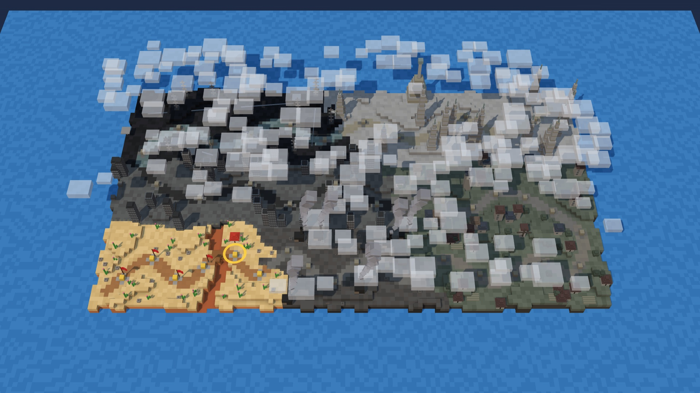

# The Overworld Map (persistent series asset)



The map is defined once in `engine/map.js` and is **never redesigned**. It's built from a fixed seed, so it renders identically every time. Each episode passes only its episode number:

```js
buildMap({ episode: 5 })   // stops 1–4 cleared (flags), stop 5 current (gold ring), regions after the current one fogged
```

## What changes per episode (state only)

| Thing | Rule |
|---|---|
| Cleared stops | Every stop before the current episode gets a red flag (waving). |
| Current stop | Gold pulsing ring. Bob stands here; the flag for this stop is planted at the end of the episode. |
| Current region | Full colour plus a soft gold sparkle along its border. |
| Regions already passed | Full colour, details animate (flags wave, chimney smoke, network packets move). |
| Regions not reached | Desaturated and dimmed, covered by drifting voxel clouds. Foundry smoke still shows through the fog as a tease. |

## Layout

One continuous winding path from bottom-left (start) to top-right (end). 7 regions × 6 stops = **42 stops**.

| Region | Stops | Look |
|---|---|---|
| The Desert | 1–6 | Sand, cacti, the canyon from Ep 4 with a bridge, the friend's red-roof house |
| The Foundry | 7–12 | Dark rock, furnaces, chimneys with smoke, lava channels |
| The Village | 13–18 | Grass, red-roof houses, fields, a windmill |
| The Town | 19–24 | Taller houses, coloured roofs, a clock tower |
| The City | 25–30 | Grey towers |
| The Network | 31–36 | Dark ground, glowing cables, antennas, dishes, moving packets |
| The Capital | 37–42 | White and gold spires, a central citadel |

## Episodes so far

| Stop | Episode |
|---|---|
| 1 | What is a computer? (not what you think) |
| 2 | Why Computers Only Understand 1s and 0s |
| 3 | How to Count in Binary Using Only On and Off |
| 4 | How Binary Became Text |
| 5 | How Numbers Became Pictures (this episode) |
